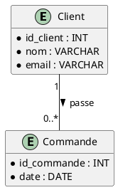
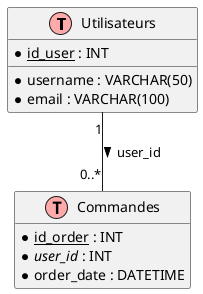
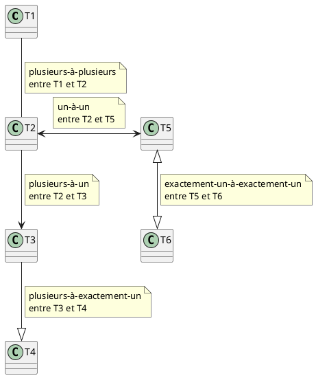
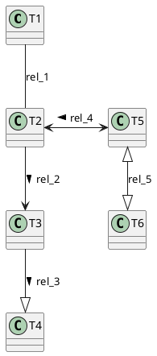
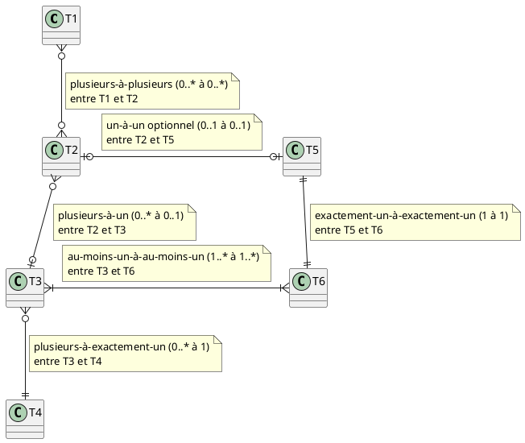

# Guide de Modélisation et Notations (PlantUML)

Ce document rassemble l'ensemble des règles et notations de modélisation pour la conception de bases de données avec **PlantUML**. 

Il est divisé en deux parties :

1. **La notation officielle du cours** : standard obligatoire à maîtriser et à appliquer pour l'ensemble des exercices, travaux pratiques et examens.
2. **Les autres notations et représentations historiques** : section d'ouverture pour la culture générale, strictement optionnelle et non autorisée lors des évaluations.

---

## 1. Notation et standards du cours (Obligatoire)

Dans ce cours, nous utilisons une **notation UML avec cardinalités et multiplicités numériques** (ex. : `1`, `0..1`, `1..*`, `0..*`), plus rigoureuse et universelle, plutôt que la notation en « pattes de corbeau » (*Crow's Foot*) ou les flèches d'héritage.

### 1.1. Principes généraux de style

* **Notation des cardinalités :** Utilisation exclusive des multiplicités UML sous forme de chaînes numériques aux extrémités des relations (ex. : `"1" -- "0..*"`).
* **Épuration visuelle :** Utilisation systématique des directives `hide empty methods` et `hide empty fields` pour masquer les sections inutilisées des classes UML et produire des diagrammes centrés sur les données.
* **Sémantique rigoureuse :** Distinction explicite entre le **Modèle Logique (MLD / DEA)** et le **Modèle Physique (MPD)** via des macros PlantUML dédiées.

### 1.2. Les trois niveaux de modélisation

Pour rappel, la conception d'une base de données s'effectue en trois étapes progressives :

1. **Modèle Conceptuel de Données (MCD)** :
    * Diagramme de travail ou de cadrage initial (brouillon).
    * Très épuré, centré uniquement sur les entités métier et leurs associations directes.
    * Sans types de données SQL, sans colonnes techniques et sans clés étrangères.
2. **Modèle Logique de Données (MLD / DEA final)** :
    * Version finale, validée et complète du **Diagramme Entité-Association (DEA)**.
    * Décrit les entités, leurs attributs avec types conceptuels, et les contraintes d'obligation.
    * Conserve des **entités** et des **associations** directes (y compris les associations plusieurs-à-plusieurs $N:M$).
    * **Ne contient aucune clé étrangère** (ce concept technique n'existe pas encore à ce niveau).
3. **Modèle Physique de Données (MPD)** :
    * Traduction directe vers le modèle relationnel prêt pour l'implémentation dans un SGBD.
    * Contient des **tables** (et non plus des entités) avec des types SQL précis.
    * Les associations plusieurs-à-plusieurs sont converties en **tables d'association** (ou tables de jonction).
    * Toutes les associations sont matérialisées par des **clés primaires (`PK`)** et des **clés étrangères (`FK`)**.

---

### 1.3. La démarche de modélisation pas à pas

En pratique, la conception d'un modèle de données ne s'effectue pas d'un seul bloc. On procède de manière incrémentale à travers **cinq étapes principales**.

!!! info "Une démarche flexible et itérative"
    Ce processus de modélisation est conçu pour être appliqué **de façon pragmatique et flexible**, et non comme un carcan strict ou absolu. Lors d'un projet réel, il est tout à fait naturel de faire des allers-retours entre les étapes (par exemple, ajuster une association lorsqu'un nouvel attribut est découvert, ou scinder une entité complexe).

1. **Identification des entités** :
    * À partir de l'analyse du domaine métier ou de la lecture du cahier des charges, on commence par repérer les concepts clés, les objets du monde réel, les personnes ou les notions qui possèdent une existence autonome et sur lesquels on souhaite conserver des données.
    * *Exemples :* `Client`, `Compte`, `Étudiant`, `Cours`, `Enseignant`.

2. **Identification des associations (sans cardinalités)** :
    * On recherche les liens sémantiques reliant ces entités entre elles, souvent révélés par les verbes d'action ou d'état dans les règles de gestion.
    * *Exemples :* un `Client` *possède* un `Compte` ; un `Étudiant` *est conseillé par* un `Enseignant`.
    * À ce stade, on trace simplement les lignes reliant les entités afin de construire le squelette relationnel du domaine, **sans encore se préoccuper des quantités ou cardinalités**.

3. **Ajout des cardinalités (multiplicités)** :
    * On quantifie la nature de chaque lien : combien d'occurrences d'une entité peuvent être associées à une occurrence de l'autre entité ?
    * **La règle d'or pour déterminer les cardinalités :**
        Pour toute association reliant deux entités $A$ et $B$ :
        1. **Fixer une instance particulière d'un côté :** On se place mentalement du côté de l'entité $A$, et on imagine **un seul élément précis** de cette entité (ex. : « *Je pense à UN client particulier* » ou « *UN compte bancaire précis* »).
        2. **Poser la question vers l'autre côté :** On se demande : *« À combien d'éléments de l'entité $B$ (au minimum et au maximum) cet élément particulier de $A$ peut-il être associé ? »*. La réponse (ex. : `0..1`, `1`, `0..*`, `1..*`) s'inscrit **du côté de l'entité $B$**.
        3. **Répéter le raisonnement dans l'autre sens :** On se place ensuite du côté de l'entité $B$, on fixe **une instance particulière** de $B$, et on se demande à combien d'éléments de $A$ elle correspond au minimum et au maximum. La réponse s'inscrit **du côté de l'entité $A$**.
        4. **Généraliser :** On applique méthodiquement cette règle à chaque association du diagramme.

4. **Ajout des attributs (Modèle Conceptuel complet)** :
    * On enrichit chaque entité avec ses propriétés descriptives (données textuelles, montants, dates, etc.).
    * À la fin de cette quatrième étape, le **Modèle Conceptuel de Données (MCD)** est complet. C'est le diagramme de travail idéal pour échanger avec les parties prenantes et valider les besoins métier sans jargon technique.

5. **Vers le Modèle Logique : ajout des types et des contraintes** :
    * Pour formaliser le brouillon conceptuel et produire le **Modèle Logique de Données (MLD / DEA final)** :
        * On attribue des types de données conceptuels (`INT`, `VARCHAR`, `DECIMAL`, `DATE`, etc.).
        * On détermine l'identifiant unique ou clé primaire (`PK`, ou souligné / astérisque).
        * On spécifie les contraintes de nullité : identification des attributs obligatoires (précédés d'un astérisque `*` / non-nuls) et des attributs optionnels (pouvant accepter la valeur `NULL`).
    * **Rappel fondamental :** À ce niveau, le diagramme ne contient **aucune clé étrangère** ! Les associations directes (y compris plusieurs-à-plusieurs $N:M$) sont préservées.

*(La transition ultérieure vers le **Modèle Physique (MPD)** convertira les entités en tables, les associations $N:M$ en tables de jonction, et matérialisera les liens par des clés étrangères).*

---

### 1.4. Modèle Logique de Données (MLD / DEA)

Le modèle logique décrit les entités métier et leurs **associations** de manière abstraite, sans introduire de détails d'implémentation ni de clés étrangères techniques.

#### Syntaxe PlantUML

* **Entités :** Mot-clé natif `entity`. PlantUML ajoute automatiquement l'icône de stéréotype **(E)**.
* **Attributs :** Liste simple des propriétés métier avec leur type conceptuel. Un attribut obligatoire est préfixé d'une étoile `*` (qui s'affiche sous forme de cercle plein).
* **Associations :** Liens directs entre entités avec multiplicités UML (`"1" -- "0..*"`) et étiquettes directionnelles (ex. `: passe >`).

#### Exemple complet (MLD)

<details>
<summary>Code source PlantUML</summary>



</details>


---

### 1.5. Modèle Physique de Données (MPD)

Le modèle physique est directement préparé pour la rédaction des instructions SQL `CREATE TABLE`. Il inclut les types de données SQL exacts, les clés primaires et étrangères, ainsi que les contraintes d'intégrité.

#### Macros et définitions sémantiques

Pour distinguer clairement les tables physiques des entités logiques, nous utilisons un ensemble de macros standardisées :

```plantuml
!define TABLE(name,desc) class name as "desc" << (T,#FFAAAA) >>
!define PK(x) <u>x</u>
!define FK(x) <i>x</i>
```

* `TABLE(name, desc)` : Définit une table relationnelle avec un stéréotype et une icône rouge **(T)**.
* `PK(nom)` : Marque une **Clé Primaire** en soulignant le nom de la colonne.
* `FK(nom)` : Marque une **Clé Étrangère** en affichant le nom de la colonne en italique.

#### Règles de notation du MPD

* **Tables :** Déclarées avec la macro `TABLE`.
* **Icône :** Directive `skinparam classIconStyle false` pour permettre l'affichage de notre icône personnalisée **(T)**.
* **Types de données :** Types SQL précis du SGBD cible (ex. : `INT`, `VARCHAR(50)`, `TIMESTAMP`, `DECIMAL(10,2)`).
* **Clés étrangères :** Chaque colonne de clé étrangère doit être explicitement déclarée dans la table avec `FK(...)`.
* **Liens :** La relation entre tables pointe explicitement vers la colonne de clé étrangère (ex. `: user_id >`).
* **Valeurs obligatoires :** Un astérisque `*` précède toute colonne non nulle (`NOT NULL`).

#### Exemple complet (MPD)

<details>
<summary>Code source PlantUML</summary>



</details>


---

### 1.6. Synthèse comparative : MLD vs MPD

| Élément | Niveau Logique (MLD / DEA) | Niveau Physique (MPD) |
| :--- | :--- | :--- |
| **Concept de base** | `entity` (Entité métier) | `TABLE` (Table relationnelle) |
| **Icône visuelle** | **(E)** (automatique PlantUML) | **(T)** (macro personnalisée) |
| **Lien** | Association directe avec sens de lecture | Relation de clé étrangère (`FK`) |
| **Clé Primaire** | Nom d'attribut identifiant (ou préfixé `*`) | `PK(colonne)` (souligné) |
| **Clé Étrangère** | *Absente (n'existe pas dans le MLD)* | `FK(colonne)` (en italique) |
| **Types de données** | Types conceptuels génériques | Types SQL concrets (`INT`, `VARCHAR(...)`, ...) |
| **Relations N:M** | Association directe plusieurs-à-plusieurs | Table d'association dédiée avec deux clés étrangères |

---

## 2. Autres notations et représentations historiques (Optionnel)

!!! warning "Section optionnelle — Non autorisée pour les travaux et examens"
    La compréhension des notations présentées dans cette section est **strictement optionnelle**. Elles sont documentées ici uniquement à titre d'information historique et de culture générale, afin de vous permettre de lire d'anciens documents ou des schémas rencontrés en entreprise ou dans la littérature.

    **Consigne pour le cours** : Vous **ne devez pas** utiliser ces notations dans le cadre de vos devoirs, travaux de session ou examens. Seule la notation UML du cours (section 1 ci-dessus) est acceptée et fera l'objet d'évaluations.

### 2.1. Notation traditionnelle du diagramme entité-association avec flèches

Historiquement, le modèle Entité-Association formalisé par Peter Chen utilisait des losanges pour les associations et des formes géométriques pour les attributs. Dans les outils textuels comme PlantUML, certains auteurs ont tenté d'utiliser des flèches pour indiquer les cardinalités maximales :

- Une extrémité sans flèche : plusieurs ($\dots \dots *$)
- Une flèche simple (`-->`) : au plus un ($\dots \dots 0..1$)
- Une flèche fermée (`--|>`) : exactement un ($\dots \dots 1$)

!!! danger "Attention au piège de syntaxe dans PlantUML"
    Dans PlantUML, la syntaxe `--|>` génère un triangle blanc qui représente traditionnellement en UML **l'héritage** (spécialisation / généralisation de classes). Utiliser cette flèche pour signifier une cardinalité « 1 » crée une confusion majeure et est **fortement proscrit**.

#### Exemple avec boîtes de notes explicatives

<details>
<summary>Code source PlantUML</summary>



</details>


#### Exemple avec étiquettes directionnelles

<details>
<summary>Code source PlantUML</summary>



</details>


---

### 2.2. Notation en « patte de corbeau » (*Crow's Foot*)

La notation en patte de corbeau (conçue par Gordon Everest et popularisée par Clive Finkelstein et James Martin) est encore très répandue dans de nombreux logiciels de modélisation de bases de données (comme MySQL Workbench ou Oracle SQL Developer Data Modeler).

Elle utilise des symboles graphiques à l'extrémité des liens :
* Une barre transversale `|` pour 1.
* Deux barres `||` pour exactement 1 (1 et 1 seul).
* Un cercle `o` pour zéro (optionnel).
* Une patte trifurquée `}` pour plusieurs ($N$).

<details>
<summary>Code source PlantUML (Crow's Foot)</summary>



</details>


Bien qu'expressive visuellement, cette notation est moins commode à manipuler en code texte et offre moins d'uniformité avec les diagrammes de classes UML que la notation adoptée dans ce cours.
