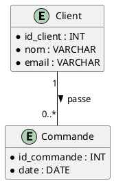
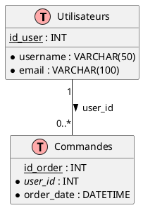

# Guide de Modélisation de Données (PlantUML)

Ce document définit les standards de modélisation utilisés pour la génération de diagrammes de données via **PlantUML**.
L'objectif est de produire des schémas clairs, utilisant une **notation UML** (multiplicités numériques) plutôt que la
notation "Crow's Foot".

## 1. Principes Généraux de Style

* **Notation des cardinalités :** Utilisation exclusive des multiplicités UML (ex: `1`, `0..*`, `1..*`, `0..1`).
* **Épuration visuelle :** Utilisation systématique de `hide empty methods` et `hide empty fields` pour transformer les
  diagrammes de classes en diagrammes de données épurés.
* **Sémantique :** Distinction claire entre le modèle conceptuel (logique) et le modèle physique via l'utilisation de
  macros personnalisées.

---

## 2. Modèle Conceptuel / Logique de Données (MCD)

Le modèle logique décrit les entités métier et leurs relations de manière abstraite.

### Syntaxe et Rendu

* **Entités :** Utilisation du mot-clé natif `entity`. PlantUML ajoute automatiquement l'icône de stéréotype **(E)**.
* **Attributs :** Liste simple des propriétés métier.
* **Relations :** Liens avec multiplicités UML.

### Exemple de Code (Standard MCD)

!!! note "Code"
    ```plantuml
    @startuml
    skinparam classIconStyle true
    hide empty methods
    hide empty fields
    
    entity Client {
        id_client : INT
        nom : VARCHAR
        email : VARCHAR
    }
    
    entity Commande {
        id_commande : INT
        date : DATE
    }
    
    Client "1" -- "0..*" Commande : passe >
    @enduml
    ```



---

## 3. Modèle Physique de Données (MPD)

Le modèle physique est prêt pour l'implémentation SQL. Il inclut les types de données précis, les contraintes de clés et
les noms de tables.

### Macros et Définitions Sémantiques

* `!define TABLE(name,desc) class name as "desc" << (T,#FFAAAA) >>` : Définit une table avec une icône **(T)** colorée.
* `!define PK(x) <u>x</u>` : Marque une **Clé Primaire** (souligné).
* `!define FK(x) <i>x</i>` : Marque une **Clé Étrangère** (italique).

### Règles de notation

* **Tables :** On utilise la macro `TABLE`.
* **Icône :** On utilise `skinparam classIconStyle false` pour éviter le conflit entre l'icône par défaut et notre macro
  `(T)`.
* **Attributs :** Les types doivent être des types SQL (ex: `VARCHAR(50)`, `INT`, `TIMESTAMP`).
* **Relations :** La relation doit faire apparaître explicitement la colonne de clé étrangère (`FK`).
* **Valeurs nulles :** Les attributs qui n'acceptent pas les valeurs nulles doivent être explicitement indiquées, en 
  plaçant un `*` avant le nom de l'attribut, qui deviendra un cercle dans le diagramme.

### Exemple de Code (Standard MPD)

!!! note "Code"
    ```plantuml
    @startuml
    !define TABLE(name,desc) class name as "desc" << (T,#FFAAAA) >>
    !define PK(x) <u>x</u>
    !define FK(x) <i>x</i>
    
    skinparam classIconStyle false
    hide empty methods
    hide empty fields
    
    TABLE(USERS, "Utilisateurs") {
        *PK(id_user) : INT
        *username : VARCHAR(50)
        *email : VARCHAR(100)
    }
    
    TABLE(ORDERS, "Commandes") {
        *PK(id_order) : INT
        *FK(user_id) : INT
        *order_date : DATETIME
    }
    
    USERS "1" -- "0..*" ORDERS : user_id >
    @enduml
    ```



---

## 5. Résumé des Notations

| Élément             | Niveau Logique (MCD)  | Niveau Physique (MPD)   | Notation UML |
|:--------------------|:----------------------|:------------------------|:-------------|
| **Objet principal** | `entity`              | `TABLE` (via macro)     | —            |
| **Icône visuelle**  | **(E)** (automatique) | **(T)** (personnalisée) | —            |
| **Clé Primaire**    | Nom de l'attribut     | `PK(nom)` (souligné)    | —            |
| **Clé Étrangère**   | Relation métier       | `FK(nom)` (italique)    | —            |
| **Type de donnée**  | Conceptuel            | SQL (ex: `VARCHAR`)     | —            |