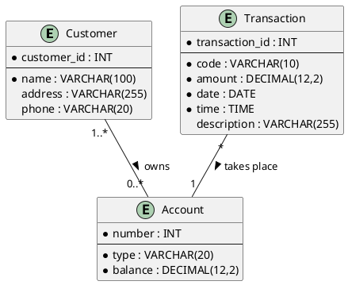
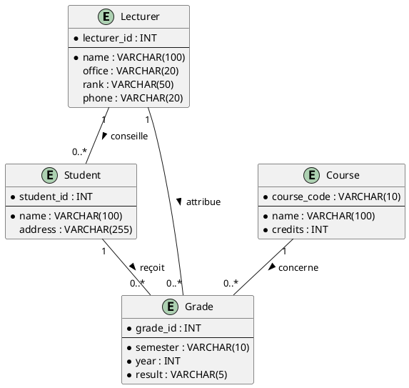
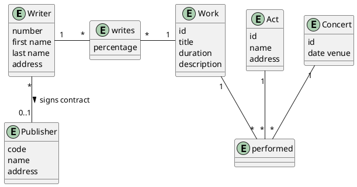
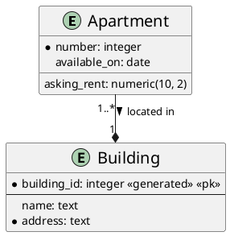

# Exemples

## Base de Données Bancaire Simple

L'application de base de données appelée BANK suit les clients d'une banque et leurs comptes :

- Les clients sont identifiés par leur nom, adresse, téléphone et ID client.
- Les comptes ont des numéros, des types (par exemple, épargne, courant) et des soldes.
- On doit enregistrer le ou les clients qui possèdent un compte.
- Une transaction a lieu sur un seul compte.
- Chaque transaction a un ID, un code, un montant, une date, une heure et une description.

### Application du processus de modélisation

Appliquons de manière progressive et flexible les 5 étapes de la démarche :

#### 1. Identification des entités

En analysant le cahier des charges, on extrait les trois concepts métiers autonomes qui représentent des objets ou
événements du domaine bancaire :

- **`Customer` (Client)** : les personnes ou entreprises faisant affaire avec la banque.
- **`Account` (Compte)** : les comptes bancaires gérés par l'institution.
- **`Transaction` (Transaction)** : les opérations financières enregistrées au fil du temps.

#### 2. Identification des associations (sans cardinalités)

On relie ces entités par les verbes d'action du domaine, sans encore chiffrer les liens :

- Un client possède un compte : association entre `Customer` et `Account` (`owns`).
- Une transaction a lieu sur un compte : association entre `Transaction` et `Account` (`takes place`).

#### 3. Ajout des cardinalités (application de la règle)

Appliquons la règle d'or pour déterminer les multiplicités à chaque extrémité :

* **Association `Customer` — `Account` (`owns`) :**
    1. *Sens Account $\rightarrow$ Customer :* On fixe **un compte particulier** (ex. : le compte nº 12345). Par combien
       de clients est-il possédé ? L'énoncé précise : « *Enregistrer également le(s) client(s) qui possèdent un
       compte* ». Un compte appartient donc au minimum à 1 client (un compte orphelin sans titulaire n'existe pas) et
       peut appartenir à plusieurs clients (compte conjoint) $\rightarrow$ cardinalité **`1..*`** du côté de `Customer`.
    2. *Sens Customer $\rightarrow$ Account :* On fixe **un client particulier** (ex. : M. Tremblay). Combien de comptes
       peut-il détenir ? Il peut détenir plusieurs comptes (chèque, épargne, etc.), ou aucun au moment de la création du
       dossier $\rightarrow$ cardinalité **`0..*`** (ou `*`) du côté de `Account`.
    3. *Conclusion :* Il s'agit d'une association **plusieurs-à-plusieurs ($N:M$)**.

* **Association `Transaction` — `Account` (`takes place`) :**
    1. *Sens Transaction $\rightarrow$ Account :* On fixe **une transaction particulière** (ex. : le retrait de 100 $
       effectué le 24 mai à 14h00). Sur combien de comptes a-t-elle lieu ? L'énoncé est catégorique : « *Une transaction
       a lieu sur un seul compte* » $\rightarrow$ cardinalité exactement **`1`** (ou `1..1`) du côté de `Account`.
    2. *Sens Account $\rightarrow$ Transaction :* On fixe **un compte particulier**. Combien de transactions peuvent s'y
       dérouler ? Un compte qui vient d'être ouvert peut n'avoir aucune transaction au départ (`0`), puis accumuler une
       infinité d'opérations au fil de sa vie (`*`) $\rightarrow$ cardinalité **`0..*`** (ou `*`) du côté de
       `Transaction`.
    3. *Conclusion :* Il s'agit d'une association **un-à-plusieurs ($1:N$)**.

#### 4. Ajout des attributs (Modèle Conceptuel complet)

On rattache les données spécifiées dans l'énoncé à chaque entité :

- `Customer` : `customer_id`, `name`, `address`, `phone`.
- `Account` : `number`, `type`, `balance`.
- `Transaction` : `transaction_id`, `code`, `amount`, `date`, `time`, `description`.

À ce stade, le **Modèle Conceptuel de Données (MCD)** est complet et permet de valider le domaine avec la banque.

#### 5. Vers le Modèle Logique : ajout des types et des contraintes

Pour aboutir au **Modèle Logique de Données (MLD / DEA final)** :

- On attribue des types conceptuels à chaque attribut (`INT`, `VARCHAR(100)`, `DECIMAL(12,2)`, `DATE`, `TIME`, etc.).
- On identifie les clés primaires (`PK`) : `customer_id`, `number` et `transaction_id`.
- On précise les contraintes de nullité : les identifiants et les champs obligatoires sont marqués d'un astérisque `*`
  (`NOT NULL`). La `description` d'une transaction peut être optionnelle (nullable).
- **Rappel :** Aucune clé étrangère n'apparaît à ce niveau ; l'association $N:M$ reste un lien direct entre `Customer`
  et `Account`.

#### Diagramme Logique (MLD)

    
Code source PlantUML

    
Ancienne notation traditionnelle

    

 

## Base de Données d'un Collège

Dans cette base de données collégiale, vous devez enregistrer les étudiants, les enseignants, les cours, les notes et
les conseillers étudiants :

- Chaque étudiant a un numéro d'étudiant, un nom et une adresse.
- Chaque enseignant a un numéro d'employé, un nom, un numéro de bureau, un rang et un numéro de téléphone.
- Pour chaque cours, son code, son nom et son nombre de crédits sont enregistrés.
- Une note est donnée à un étudiant par un enseignant pour un cours enseigné pendant un semestre (A, B ou C) d'une année
  particulière.
- Les conseillers des étudiants sont des enseignants.

### Application du processus de modélisation

#### 1. Identification des entités

L'énoncé fait ressortir les grands concepts du milieu collégial :

- **`Student` (Étudiant)** : les étudiants inscrits au collège.
- **`Lecturer` (Enseignant)** : les professeurs dispensant les cours et assurant le tutorat.
- **`Course` (Cours)** : les cours offerts au programme.
- **`Grade` (Note / Évaluation)** : l'évaluation obtenue par un étudiant dans un cours donné, attribuée par un
  enseignant à un semestre précis. *(Remarque pédagogique : une note pourrait être modélisée au niveau conceptuel comme
  une association ternaire entre Étudiant, Enseignant et Cours avec attributs. Cependant, la transformer directement en
  une entité autonome `Grade` rend le modèle beaucoup plus clair et facilite la transition vers le modèle relationnel).*

#### 2. Identification des associations (sans cardinalités)

On relie les entités selon les besoins exprimés :

- Relation de conseiller : `Student` — `Lecturer` (`advisor` / `est conseillé par`).
- Relations d'évaluation :
    - `Student` — `Grade` (l'étudiant qui reçoit l'évaluation).
    - `Lecturer` — `Grade` (l'enseignant qui évalue et attribue la note).
    - `Course` — `Grade` (le cours dans lequel l'évaluation a lieu).

#### 3. Ajout des cardinalités (application de la règle)

Appliquons la règle de fixation d'une instance pour chaque association :

* **Association de conseiller (`Student` — `Lecturer`) :**
    1. *Sens Student $\rightarrow$ Lecturer :* On fixe **un étudiant particulier**. Combien de conseillers pédagogiques
       a-t-il ? L'énoncé indique que les conseillers des étudiants sont des enseignants. Généralement, un étudiant a
       exactement un conseiller assigné (ou au plus un si l'attribution se fait après l'admission) $\rightarrow$
       cardinalité **`1`** (ou `0..1`) du côté de `Lecturer`.
    2. *Sens Lecturer $\rightarrow$ Student :* On fixe **un enseignant particulier**. Combien d'étudiants
       conseille-t-il ? Un enseignant peut conseiller plusieurs étudiants, ou aucun s'il se consacre uniquement à la
       recherche ou à l'enseignement $\rightarrow$ cardinalité **`0..*`** du côté de `Student`.
    3. *Conclusion :* Association **un-à-plusieurs ($1:N$)**.

* **Associations autour de l'entité `Grade` :**
    1. *Lien `Grade` — `Student` :*
         - On fixe **une note spécifique** sur un relevé : à combien d'étudiants appartient-elle ? À exactement **`1`**
           étudiant du côté de `Student`.
         - On fixe **un étudiant particulier** : combien de notes peut-il accumuler au cours de son parcours ? Au fil
           des sessions, il reçoit **`0..*`** notes du côté de `Grade`.
    2. *Lien `Grade` — `Lecturer` :*
         - On fixe **une note spécifique** : par combien d'enseignants est-elle accordée ? Par exactement **`1`**
           enseignant du côté de `Lecturer`.
         - On fixe **un enseignant particulier** : combien de notes décerne-t-il ? Il note de multiples étudiants dans
           ses différents groupes $\rightarrow$ **`0..*`** du côté de `Grade`.
    3. *Lien `Grade` — `Course` :*
         - On fixe **une note spécifique** : pour combien de cours est-elle valide ? Pour exactement **`1`** cours du
           côté de `Course`.
         - On fixe **un cours particulier** : combien de notes y sont attribuées au total ? Tous les étudiants inscrits
           à ce cours reçoivent une note $\rightarrow$ **`0..*`** du côté de `Grade`.

#### 4. Ajout des attributs (Modèle Conceptuel complet)

On répartit les caractéristiques mentionnées :

- `Student` : `student_id`, `name`, `address`.
- `Lecturer` : `lecturer_id`, `name`, `office`, `rank`, `phone`.
- `Course` : `course_code`, `name`, `credits`.
- `Grade` : `semester`, `year`, `result`.

Le **Modèle Conceptuel de Données (MCD)** est désormais complet.

#### 5. Vers le Modèle Logique : ajout des types et des contraintes

Pour finaliser le **Modèle Logique de Données (MLD / DEA final)** :

- On spécifie les types conceptuels (`INT`, `VARCHAR(100)`, `VARCHAR(10)`, etc.).
- On définit les clés primaires (`PK`) : `student_id`, `lecturer_id`, `course_code` et un identifiant unique `grade_id`.
- On précise les contraintes de nullité (`*` pour les attributs obligatoires).
- **Rappel :** Aucune clé étrangère (`advisor_id`, `student_id`, etc.) n'est ajoutée dans les entités ; elles demeurent
  unies par leurs associations logiques.

#### Diagramme Logique (MLD)

    
Code source PlantUML

    
Anciennes notations traditionnelles

    
<strong>Avec association ternaire <em>grade</em> :</strong>

    
    
<strong>Avec entité <em>grade</em> :</strong>

    

 

## Base de Données des Droits d'Auteur de Musique

- Vous êtes chargé de concevoir une base de données pour une agence de collecte
  de droits d'auteur de musique, incluant les informations suivantes :
    - Un auteur a un numéro d'auteur, un prénom, un nom de famille et une
      adresse.
    - Les auteurs peuvent être signés avec un éditeur. Les éditeurs signent de
      nombreux auteurs.
    - Les éditeurs ont un code éditeur, un nom et une adresse.
    - Les auteurs écrivent des œuvres. Les œuvres peuvent avoir plus d'un
      auteur. Chaque auteur écrit un pourcentage d'une œuvre.
    - Une œuvre a un titre, une durée et une description.
    - Les œuvres sont interprétées lors de concerts (ou spectacles de musique)
      par un groupe.
    - Un concert a une date et un lieu.

    
Traditionnelle

    

    
UML

    

    
Code

 

## Appartements à Louer

- Vous devez concevoir une base de données pour gérer les informations d'une
  entreprise gérant un ensemble d'appartements à louer.
    - Cette entreprise gère de nombreux bâtiments, chacun composé d'au moins un
      appartement.
    - Supposons qu'un appartement puisse être identifié de manière unique par
      son numéro dans son bâtiment.
    - Pour chaque appartement, il y a au moins un locataire, s'il est loué.
    - Le loyer mensuel et la date de fin de bail (si connue) doivent être
      inclus.
    - Pour chaque appartement disponible prochainement, la date de disponibilité
      et le loyer mensuel demandé doivent être inclus.
    - Pour chaque locataire, le prénom, le nom de famille, le numéro de
      téléphone à domicile, le nom de son employeur et son numéro de téléphone
      professionnel doivent être inclus.

- Cette date de fin de bail n'est pas toujours le jour suivant la fin du bail
  précédent car un appartement pourrait être indisponible pendant un certain
  temps en raison de rénovations, par exemple.
- En suivant un raisonnement similaire, le loyer mensuel demandé n'est pas
  nécessairement le même que le loyer actuel.

### Entité Faible : Appartement

#### Notation Traditionnelle

    
Traditionnelle 1

    

    
Traditionnelle 2

    

    
UML

    

    
Code

 

### Appartements à Louer

#### Diagramme Complet

    
Traditionnelle

    

    
UML

    

 

#### Diagramme Amélioré

    
Traditionnelle

    

    
UML

    

 
