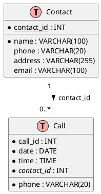
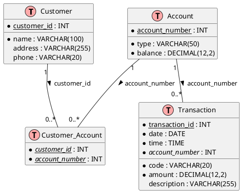
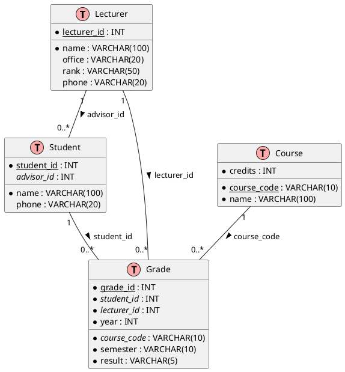
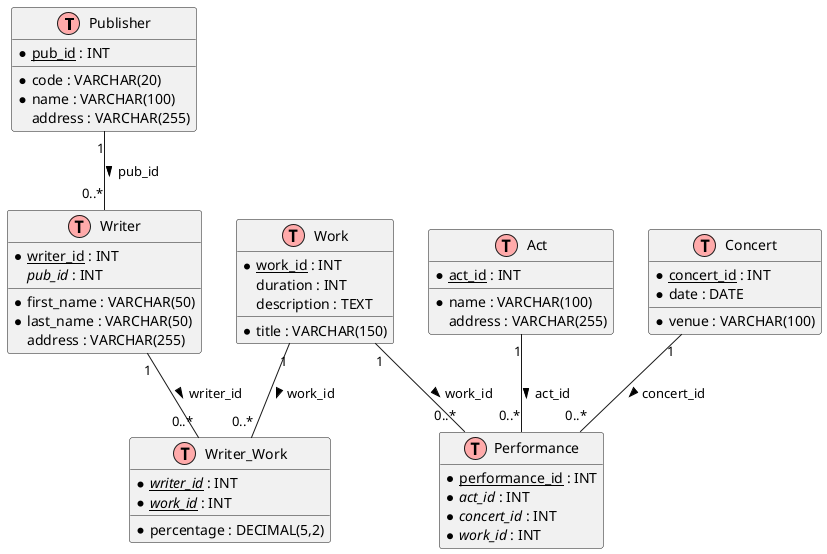

# Du Modèle Logique (DEA) au Modèle Physique et à la Base de Données

Ce document présente la transition pragmatique entre le **Modèle Logique** (la version finale et détaillée du diagramme
entité-association) et le **Modèle Physique de Données (MPD)**, puis son implémentation concrète sous forme de tables
relationnelles via des instructions SQL `CREATE TABLE`.

!!! info "Rappel terminologique : « Association » vs « Relation »"
    Dans un **Modèle Entité-Association (DEA)**, le lien sémantique unissant deux entités est une **association** (*relationship* en anglais). Le mot **relation** (*relation* en anglais) est quant à lui réservé au modèle relationnel pour désigner une **table** de données. Ainsi, on transforme des *associations* conceptuelles/logiques en tables ou en contraintes de clés étrangères au sein d'un schéma *relationnel*.

---

## 1. La démarche de modélisation en trois niveaux

Dans une approche moderne et efficace de conception de bases de données, nous distinguons trois étapes clés
successives :

1. **Le Modèle Conceptuel de Données (MCD) — Le diagramme de travail (brouillon)** :
    - Il s'agit d'une première ébauche pour explorer le domaine métier avec les parties prenantes.
    - On y identifie les grandes entités du domaine et les associations fondamentales, sans se soucier des détails
      techniques (types de données SQL, clés étrangères ou contraintes précises).

2. **Le Modèle Logique de Données (MLD / DEA final)** :
    - C'est la version finale, stabilisée et complète du **Diagramme Entité-Association (DEA)**.
    - Il contient des **entités** (et non des tables).
    - Il définit les attributs, les types de données conceptuels et les identifiants (clés primaires).
    - Il conserve des associations directes, y compris les **associations plusieurs-à-plusieurs ($N:M$)**.
    - **Aucune clé étrangère n'apparaît à ce niveau** : la clé étrangère est un mécanisme purement technique propre au
      modèle relationnel.

3. **Le Modèle Physique de Données (MPD)** :
    - Il s'agit de la traduction directe du modèle logique en vue de son implémentation dans un SGBD relationnel.
    - Il est constitué de **tables** (et non plus d'entités) et de colonnes.
    - Les types de données deviennent des types SQL concrets (`INT`, `VARCHAR(100)`, `DECIMAL(10,2)`, `DATE`, etc.).
    - Toutes les associations sont désormais matérialisées par des **clés étrangères (`FK`)** ou des tables dédiées.
    - Chaque association plusieurs-à-plusieurs est transformée en une **table d'association** (ou table de jonction).

Une fois le Modèle Physique validé, l'étape finale consiste à générer le script SQL de création (`CREATE TABLE`,
contraintes `PRIMARY KEY`, `FOREIGN KEY`, `NOT NULL`, etc.).

---

## 2. Règles de transformation : du Logique (DEA) au Physique (MPD)

La conversion d'un diagramme logique vers un diagramme physique repose sur quatre règles fondamentales.

### Règle 1 : Les entités deviennent des tables

- Chaque **entité** du modèle logique devient une **table** dans le modèle physique.
- Tous les attributs de l'entité deviennent des **colonnes** dans la table.
- Les identifiants de l'entité deviennent les colonnes de la **clé primaire (`PK`)** de la table.

### Règle 2 : Les associations plusieurs-à-plusieurs ($N:M$) deviennent des tables d'association

Dans le modèle relationnel, deux tables ne peuvent pas être directement associées par une association
plusieurs-à-plusieurs sans violer la première forme normale ou introduire des redondances incohérentes.

- Chaque association **plusieurs-à-plusieurs** ($* \dots *$ ou $N:M$) devient une **nouvelle table** (table
  d'association ou table de jonction).
- Cette table contient au minimum deux colonnes de **clés étrangères (`FK`)**, chacune pointant vers la clé primaire
  d'une des tables impliquées dans l'association.
- La clé primaire (`PK`) de la table d'association est couramment composée de la combinaison de ces clés étrangères (clé
  primaire composite), ou d'un identifiant numérique propre.
- Si l'association possédait des attributs propres dans le modèle logique (ex. : une date, une quantité, un
  pourcentage), ceux-ci deviennent des colonnes de cette nouvelle table.

!!! tip "Règle de comptage"
    Nombre minimal de tables dans le schéma relationnel = **Nombre d'entités + Nombre d'associations plusieurs-à-plusieurs**.


### Règle 3 : Les associations un-à-plusieurs ($1:N$) deviennent des clés étrangères

- Une association **un-à-plusieurs** ne devient **JAMAIS** une nouvelle table.
- La règle consiste à faire migrer la clé primaire du côté « un » ($1$ ou $0..1$) comme **clé étrangère (`FK`)** dans la
  table située du côté « plusieurs » ($*$).
- **Contrainte de nullité** :
    - Si la cardinalité du côté « un » est obligatoire ($1..1$), la colonne de clé étrangère doit être marquée
      `NOT NULL`.
    - Si la cardinalité du côté « un » est optionnelle ($0..1$), la colonne de clé étrangère peut accepter la valeur
      `NULL`.

### Règle 4 : Les associations un-à-un ($1:1$) deviennent des clés étrangères uniques

- Une association **un-à-un** ne devient **JAMAIS** une nouvelle table.
- On place une **clé étrangère (`FK`)** dans l'une des deux tables, pointant vers la clé primaire de l'autre.
- Pour garantir que l'association demeure strictement un-à-un, la colonne de clé étrangère doit obligatoirement être
  assortie d'une contrainte d'unicité (`UNIQUE`).
- **Choix du côté** :
    - Si un côté est optionnel ($0..1$) et l'autre obligatoire ($1..1$), on place généralement la clé étrangère dans la
      table du côté optionnel ($0..1$), évitant ainsi d'avoir des colonnes avec valeurs `NULL` dans la table
      obligatoire.
    - Si les deux côtés ont la même cardinalité, le choix dépend de la logique métier et de la table la plus fréquemment
      consultée.

---

## 3. Exemples de conversion

Voyons comment ces règles s'appliquent sur des cas concrets en comparant le modèle logique de départ et le modèle
physique résultant.

### Exemple 1 : Contacts et Appels

Un contact peut recevoir plusieurs appels téléphoniques, mais chaque appel est associé à exactement un contact
(association $1:N$).

#### Modèle Logique (DEA)

Dans le modèle logique, nous avons deux entités reliées par une association $1:N$ sans aucune clé étrangère :


#### Modèle Physique (MPD)

Application des règles :

1. Les entités `Contact` et `Call` deviennent des tables.
2. L'association $1:N$ se traduit par l'ajout de la colonne `contact_id` comme clé étrangère dans la table `Call`. Comme
   chaque appel provient d'un contact existant, elle est marquée `NOT NULL`.



??? note "Code PlantUML"
    ```plantuml
    @startuml
    !define TABLE(name,desc) class name as "desc" << (T,#FFAAAA) >>
    !define PK(x) <u>x</u>
    !define FK(x) <i>x</i>

    skinparam classIconStyle false
    hide empty methods
    hide empty fields

    TABLE(Contact, "Contact") {
        *PK(contact_id) : INT
        *name : VARCHAR(100)
        phone : VARCHAR(20)
        address : VARCHAR(255)
        email : VARCHAR(100)
    }

    TABLE(Call, "Call") {
        *PK(call_id) : INT
        *phone : VARCHAR(20)
        *date : DATE
        *time : TIME
        *FK(contact_id) : INT
    }

    Contact "1" -- "0..*" Call : contact_id >
    @enduml
    ```

---

### Exemple 2 : Banque Simple (Simple Bank)

Dans une banque :

- Un client peut posséder plusieurs comptes, et un compte peut être détenu par plusieurs clients (association
  plusieurs-à-plusieurs $N:M$).
- Un compte enregistre plusieurs transactions, mais chaque transaction concerne un seul compte (association
  un-à-plusieurs $1:N$).

#### Modèle Logique (DEA)


#### Modèle Physique (MPD)

Application des règles :

1. Les 3 entités (`Customer`, `Account`, `Transaction`) deviennent 3 tables de base.
2. L'association plusieurs-à-plusieurs entre `Customer` et `Account` devient une $4^e$ table : `Customer_Account` (table
   de liaison avec clé primaire composite).
3. L'association un-à-plusieurs entre `Account` et `Transaction` se traduit par l'ajout de `account_number` comme clé
   étrangère dans la table `Transaction`.



??? note "Code PlantUML"
    ```plantuml
    @startuml
    !define TABLE(name,desc) class name as "desc" << (T,#FFAAAA) >>
    !define PK(x) <u>x</u>
    !define FK(x) <i>x</i>

    skinparam classIconStyle false
    hide empty methods
    hide empty fields

    TABLE(Customer, "Customer") {
        *PK(customer_id) : INT
        *name : VARCHAR(100)
        address : VARCHAR(255)
        phone : VARCHAR(20)
    }

    TABLE(Account, "Account") {
        *PK(account_number) : INT
        *type : VARCHAR(50)
        *balance : DECIMAL(12,2)
    }

    TABLE(Customer_Account, "Customer_Account") {
        *PK(FK(customer_id)) : INT
        *PK(FK(account_number)) : INT
    }

    TABLE(Transaction, "Transaction") {
        *PK(transaction_id) : INT
        *code : VARCHAR(20)
        *amount : DECIMAL(12,2)
        *date : DATE
        *time : TIME
        description : VARCHAR(255)
        *FK(account_number) : INT
    }

    Customer "1" -- "0..*" Customer_Account : customer_id >
    Account "1" -- "0..*" Customer_Account : account_number >
    Account "1" -- "0..*" Transaction : account_number >
    @enduml
    ```

---

### Exemple 3 : Collège

Dans cet exemple :

- Un étudiant a un conseiller qui est un enseignant (association $1:N$ entre `Lecturer` et `Student`).
- Une note (`Grade`) relie un étudiant, un enseignant et un cours pour un semestre et une année donnés, avec un
  résultat.

#### Modèle Logique (DEA)


#### Modèle Physique (MPD)

Application des règles :

1. `Student`, `Lecturer` et `Course` deviennent des tables.
2. L'association de conseiller ($1:N$) insère `advisor_id` comme clé étrangère dans la table `Student`.
3. L'évaluation `Grade` est modélisée par une table contenant les clés étrangères vers `Student`, `Lecturer` et
   `Course`, ainsi que ses attributs propres (`semester`, `year`, `result`).



---

### Exemple 4 : Droits d'auteur de Musique

Dans cet exemple :

- Les auteurs (`Writer`) peuvent signer chez un éditeur (`Publisher`, association $N:1$).
- Les auteurs écrivent des œuvres (`Work`) avec un pourcentage de contribution (association $N:M$ porteuse d'attribut).
- Les représentations (`Performance`) associent un groupe (`Act`), un concert (`Concert`) et une œuvre (`Work`).

#### Modèle Logique (DEA)


#### Modèle Physique (MPD)

Application des règles :

1. `Writer`, `Publisher`, `Work`, `Act` et `Concert` forment les tables de base.
2. `Writer` reçoit la clé étrangère `pub_id` référant `Publisher`.
3. L'association $N:M$ entre `Writer` et `Work` devient la table `Writer_Work`, qui contient les clés étrangères
   `writer_id`, `work_id` et l'attribut `percentage`.
4. L'association ternaire d'exécution devient la table `Performance` avec les clés étrangères `act_id`, `concert_id` et
   `work_id`.



---

### Exemple 5 : Gestion d'immeubles et appartements

Dans cet exemple :

- Un immeuble (`Building`) contient plusieurs appartements (`Apartment`). Un appartement est une entité dépendante de
  son immeuble.
- Un bail (`Lease`) concerne un appartement spécifique.
- Plusieurs locataires (`Tenant`) peuvent signer un même bail (association $N:M$).

#### Modèle Logique (DEA)


#### Modèle Physique (MPD)

Application des règles :

1. `Building` devient une table.
2. `Apartment` possède une clé primaire composite (`building_id`, `number`) où `building_id` est aussi une clé étrangère
   vers `Building`.
3. `Lease` référence directement l'appartement via sa clé étrangère composite (`building_id`, `apartment_number`).
4. L'association entre `Tenant` et `Lease` devient la table d'association `Tenant_Lease`.


---

## 4. Création de la base de données en SQL (DDL)

Une fois le Modèle Physique validé, nous pouvons générer les instructions SQL de définition des données
(`CREATE TABLE`).

### Ordre de création des tables et tri topologique

Lors de l'exécution d'un script SQL de création, une règle stricte d'intégrité référentielle s'applique : **une
table $A$ ne peut référencer une table $B$ via une clé étrangère que si la table $B$ a déjà été créée**.

Pour déterminer l'ordre exact dans lequel exécuter les instructions `CREATE TABLE`, on utilise un **tri topologique**.

#### Qu'est-ce qu'un tri topologique ?

Dans la théorie des graphes, si l'on représente les tables comme les sommets d'un graphe orienté et les dépendances de
clés étrangères comme des flèches ($A \rightarrow B$ signifiant que la table $A$ référence la table $B$), le **tri
topologique** est un ordonnancement linéaire de tous les sommets tel que chaque table référencée apparaisse
obligatoirement **avant** les tables qui en dépendent.

Ce tri est possible dès lors que le graphe est un **graphe orienté acyclique** (DAG — *Directed Acyclic Graph*),
c'est-à-dire sans boucle de dépendances.

La stratégie pratique est simple :

1. **Étape 1** : Créer en premier les tables indépendantes (qui n'ont aucune clé étrangère).
2. **Étape 2** : Créer ensuite les tables qui ne dépendent que des tables déjà créées.
3. **Étape 3** : Créer en dernier les tables d'association (qui dépendent de plusieurs tables préexistantes).

Lors de la suppression des tables (`DROP TABLE`), l'ordre est exactement l'**inverse** du tri topologique (on supprime
d'abord les tables dépendantes, puis les tables indépendantes).

---

### Exemple complet d'implémentation SQL : Simple Bank

Appliquons le tri topologique au Modèle Physique de **Simple Bank** :

- `Customer` : 0 dépendance
- `Account` : 0 dépendance
- `Transaction` : dépend de `Account`
- `Customer_Account` : dépend de `Customer` et de `Account`

Un ordre valide issu du tri topologique est donc :

1. `Customer`
2. `Account`
3. `Transaction`
4. `Customer_Account`

Voici le script SQL complet prêt à être exécuté :

```sql
-- -------------------------------------------------------------
-- 0. Nettoyage initial (ordre inverse du tri topologique)
-- -------------------------------------------------------------
DROP TABLE IF EXISTS customer_account;
DROP TABLE IF EXISTS transaction;
DROP TABLE IF EXISTS account;
DROP TABLE IF EXISTS customer;

-- -------------------------------------------------------------
-- 1. Tables indépendantes (racines du graphe de dépendances)
-- -------------------------------------------------------------
CREATE TABLE customer
(
    customer_id INT PRIMARY KEY,
    name        VARCHAR(100) NOT NULL,
    address     VARCHAR(255),
    phone       VARCHAR(20)
);

CREATE TABLE account
(
    account_number INT PRIMARY KEY,
    type           VARCHAR(50)    NOT NULL,
    balance        DECIMAL(12, 2) NOT NULL DEFAULT 0.00
);

-- -------------------------------------------------------------
-- 2. Tables dépendantes d'une table existante
-- -------------------------------------------------------------
CREATE TABLE transaction
(
    transaction_id INT PRIMARY KEY,
    code           VARCHAR(20)    NOT NULL,
    amount         DECIMAL(12, 2) NOT NULL,
    date           DATE           NOT NULL,
    time           TIME           NOT NULL,
    description    VARCHAR(255),
    account_number INT            NOT NULL,
    CONSTRAINT fk_transaction_account
        FOREIGN KEY (account_number) REFERENCES account (account_number)
);

-- -------------------------------------------------------------
-- 3. Tables d'association (dépendantes de plusieurs tables)
-- -------------------------------------------------------------
CREATE TABLE customer_account
(
    customer_id    INT NOT NULL,
    account_number INT NOT NULL,
    PRIMARY KEY (customer_id, account_number),
    CONSTRAINT fk_ca_customer
        FOREIGN KEY (customer_id) REFERENCES customer (customer_id)
            ON DELETE CASCADE,
    CONSTRAINT fk_ca_account
        FOREIGN KEY (account_number) REFERENCES account (account_number)
            ON DELETE CASCADE
);
```

---

### Que faire en présence de dépendances circulaires ?

Si deux tables se référencent mutuellement (par exemple, un `Employee` appartient à un `Department`, et un `Department`
a pour responsable un `Employee`), le graphe de dépendances contient un cycle. Dans ce cas, **aucun tri topologique
strict n'est possible**.

Pour résoudre cette situation :

1. On rompt temporairement la boucle lors de la création : on crée la première table sans sa clé étrangère circulaire.
2. On crée la seconde table avec sa clé étrangère vers la première.
3. On rétablit la contrainte circulaire sur la première table à l'aide d'une instruction
   `ALTER TABLE ... ADD CONSTRAINT ... FOREIGN KEY`.

Pour voir l'implémentation détaillée et les stratégies de gestion des cycles, consultez les sections dédiées :

- [Gestion des dépendances circulaires](05-circular-dep.md)
- [Cycles entre les tables Utilisateurs et Profil](06-cycles.md)
